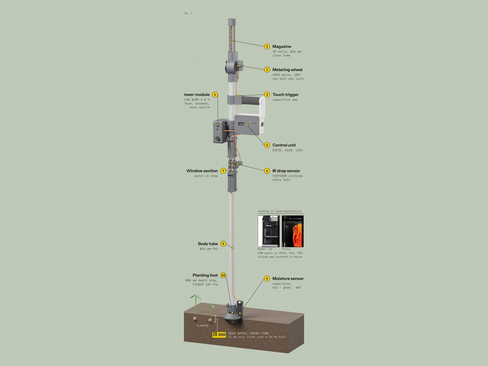

## Hi, I'm Niels 👋

Engineering student who builds things that work in the real world: **hardware prototypes** with sensors, firmware and
3D-printed parts, and **machine-learning tools** that make models easier to understand. Currently based in
Sydney.

### 🏆 Achievements

- **1st place of 60 teams** and **People's Choice Award**, UNSW Build-a-thon 2026 (RAMSoc × WIT with UNSW Founders), with [SeedStick](https://github.com/NielsN5/seedstick)

### Featured projects

<table>
  <tr>
    <td width="50%" valign="top">
      
      <h4><a href="https://github.com/NielsN5/seedstick">SeedStick</a></h4>
      Hand-held planting tool for land restoration: checks soil moisture, sets every seed ball at the same depth and
      counts and logs each one. ESP32 firmware, 24 printed parts, full build documentation.
        
      <code>ESP32</code> <code>C++</code> <code>3D printing</code> <code>sensors</code>
    </td>
    <td width="50%" valign="top">
      
      <h4><a href="https://github.com/NielsN5/data-pruning-viz">data-pruning-viz</a></h4>
      Research project at Fraunhofer IPA / University of Stuttgart: a tree-based visualization of interaction effects
      between training examples, to make data pruning decisions safer. Interactive Streamlit dashboard.
        
      <code>Python</code> <code>PyTorch</code> <code>Streamlit</code> <code>explainable AI</code>
    </td>
  </tr>
</table>

### What I work with

**Machine learning and data** 
      

**Hardware and embedded** 
      

### Contact

